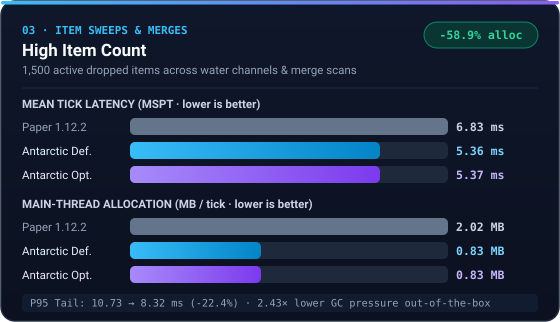

<div align="center">
  <br />
  
  <h1>Antarctic</h1>
  <p><strong>A modern, low-latency Paper <code>1.12.2</code> overhaul engineered for Java 21</strong></p>

  <p>
    <a href="https://www.minecraft.net/"></a>
    <a href="https://adoptium.net/"></a>
    <a href="https://gradle.org/"></a>
    <a href="LICENSE.md"></a>
  </p>

  <p>
    <a href="#architecture--highlights">Highlights</a> &nbsp;&bull;&nbsp;
    <a href="#benchmarks">Benchmarks</a> &nbsp;&bull;&nbsp;
    <a href="#configuration">Configuration</a> &nbsp;&bull;&nbsp;
    <a href="#building-from-source">Build</a> &nbsp;&bull;&nbsp;
    <a href="#branches">Branches</a>
  </p>
</div>

---

**Antarctic** is a high-performance Paper `1.12.2` server fork rebuilt for modern **Java 21** runtimes. It targets main-thread tick latency, heap allocation churn, and legacy concurrency bottlenecks using lock-free data structures, cache-friendly primitive pipelines, and simulation-tested vanilla parity — while preserving full `1.12.2` client, Anvil storage, and Bukkit/Paper plugin compatibility.

---

## Architecture & Highlights

<table>
  <tr>
    <td width="50%" valign="top">
      <h3>&#9889; Zero-Alloc Hot Paths &amp; Primitives</h3>
      <p>Eliminates per-tick heap churn across core NMS loops: lock-free dense <code>DataWatcher</code> arrays, per-state cached <code>FastVoxelCache</code> collision shapes, <code>ChunkSection</code> fluid/fire skip counters, zero-alloc bitmask crafting, direct NBT enchantment queries, and zero-copy <code>ByteBuffer</code> packet compression.</p>
    </td>
    <td width="50%" valign="top">
      <h3>&#128293; Physics, Lighting &amp; Tick Engines</h3>
      <p>Combines an intrusive-heap <code>ChunkIndexedTreeSet</code> with O(1) <code>ArrayDeque</code> tick batching, palette-LUT light cell packing, optional <strong>Alternate Current</strong> O(N) redstone, optimized powered-rail propagation, and an optional asynchronous bulk relight pipeline with border verification.</p>
    </td>
  </tr>
  <tr>
    <td width="50%" valign="top">
      <h3>&#128737; Vanilla Parity &amp; Exploit Hardening</h3>
      <p>Attempts to preserve vanilla movement, suffocation, redstone, and mob-spawning logic as faithfully as possible through automated logic simulations, while hardening against book crashers, oversized chunk/tile-entity overloads, unloaded-chunk digging/projectile exploits, and map-decoration floods.</p>
    </td>
    <td width="50%" valign="top">
      <h3>&#9881; Java 21 Runtime &amp; TOML Config</h3>
      <p>Compiled cleanly for <code>--release 21</code> with virtual-thread executors for blocking auth/chat I/O (zero carrier-pinning via <code>ReentrantLock</code>) and modular, documented server tuning in <code>antarctic.toml</code> with strict vanilla defaults.</p>
    </td>
  </tr>
</table>

---

## Benchmarks

> [!NOTE]
> **Simulation Disclaimer:** These measurements reflect controlled, deterministic synthetic simulations of the current `dev` state against pinned upstream Paper `1.12.2` (`antarctic-upstream`) on identical hardware and JDK 21. They are **not** indicative of real-world production operational performance, which varies heavily with player behavior, plugins, world layout, and GC tuning.

<div align="center">
  
</div>

<table>
  <tr>
    <td width="50%" align="center">
      
    </td>
    <td width="50%" align="center">
      
    </td>
  </tr>
  <tr>
    <td width="50%" align="center">
      
    </td>
    <td width="50%" align="center">
      
    </td>
  </tr>
</table>

<details>
<summary><strong>Detailed Aggregated Telemetry &amp; Simulation Methodology</strong></summary>
<br />

- **Host &amp; Runtime:** AMD Ryzen 7 7435HS (8C / 16T) &middot; OpenJDK `21.0.13` (Zulu) &middot; `-Xms2G -Xmx2G -XX:+UseG1GC`
- **Protocol:** 6 alternating fresh-JVM headless runs (2&times; Paper `1.12.2` Upstream, 2&times; Antarctic Default, 2&times; Antarctic Opt-in TOML) executing an identical Bukkit simulation plugin with fixed seed `1337`, 60 warmup ticks, and 200 sampled ticks per tick-loop scenario.
- **Measurement:** Pure active server tick CPU time via NMS `MinecraftServer.h[]` (excludes idle tick sleep) and main-thread heap allocation via `ThreadMXBean.getThreadAllocatedBytes()`.
- **Parity Check:** All 6 runs verified identical active entity lifetimes (`261.0` ticks lived), mob displacement (`5.84–5.97` blocks average travel), item counts (`1,500`), and falling-block counts (`480`).
- **Opt-in TOML Profile:** `redstone.implementation = "alternate-current"`, `rails.optimize-powered-rails = true`, `lighting.async-bulk-relight = true`.

| Scenario | Metric | Paper `1.12.2` | Antarctic (Default) | Antarctic (Opt-in) |
| :--- | :--- | ---: | ---: | ---: |
| **Chunk Loading** *(225 gen + 3&times;225 reload)* | Gen Latency (`ms/chunk`) | `9.29` | `8.46` (`-8.9%`) | `8.31` (`-10.6%`) |
| | Gen Throughput (`chunks/s`) | `108.1` | `118.2` (`+9.4%`) | `120.4` (`+11.4%`) |
| | Heap Alloc (`MB/chunk`) | `2.90` | `2.28` (`-21.6%`) | `2.28` (`-21.4%`) |
| **High Entities** *(1,000 active mobs)* | Mean MSPT (`ms`) | `19.92` | `18.40` (`-7.6%`) | `16.29` (`-18.2%`) |
| | P95 MSPT (`ms`) | `35.95` | `32.73` (`-8.9%`) | `26.73` (`-25.6%`) |
| | Heap Alloc (`MB/tick`) | `5.57` | `4.59` (`-17.6%`) | `4.51` (`-19.0%`) |
| **High Items** *(1,500 active items)* | Mean MSPT (`ms`) | `6.83` | `5.36` (`-21.5%`) | `5.37` (`-21.4%`) |
| | P95 MSPT (`ms`) | `10.73` | `8.32` (`-22.4%`) | `8.40` (`-21.7%`) |
| | Heap Alloc (`MB/tick`) | `2.02` | `0.83` (`-58.8%`) | `0.83` (`-58.9%`) |
| **High Physics** *(redstone, rails, water, sand)* | Mean MSPT (`ms`) | `5.94` | `5.15` (`-13.3%`) | `2.91` (`-50.9%`) |
| | P95 MSPT (`ms`) | `14.45` | `13.02` (`-9.9%`) | `4.61` (`-68.1%`) |
| | Heap Alloc (`MB/tick`) | `4.19` | `2.85` (`-32.0%`) | `0.65` (`-84.6%`) |

</details>

---

## Configuration

Antarctic ships with strict `1.12.2` vanilla defaults in **`antarctic.toml`** and exposes modular opt-in engines for high-load servers:

| Module | Key Options | Default |
| :--- | :--- | :--- |
| `[optimizations.physics]` | `optimize-voxel-collisions` | `true` |
| `[optimizations.redstone]` | `implementation` (`"vanilla"` \| `"eigencraft"` \| `"alternate-current"`) | `"vanilla"` |
| `[optimizations.rails]` | `optimize-powered-rails` | `false` |
| `[optimizations.lighting]` | `defer-light-updates`, `async-bulk-relight`, `verify-after-relight` | `true` / `false` / `true` |
| `[optimizations.mob-spawning]` | `support-first-spawn-filtering`, `precheck-light-mode`, `per-player-mob-spawns` | `true` / `"single-roll"` / `false` |
| `[concurrency.*]` | `virtual-threads.chat-executor`, `virtual-threads.authenticator`, `async-playerdata-saving` | `true` / `true` / `false` |

---

## Building from Source

**Prerequisites:** **JDK 21** (`JAVA_HOME`), **JDK 8** (`JAVA8_HOME`, first-time `setupSources` only), **Git**, **Python 3**, and **Bash** (Git Bash on Windows).

```bash
# 1. Clone the repository (dev branch)
git clone https://github.com/LUCKYVN-NETWORK/Antarctic.git
cd Antarctic

# 2. Decompile pinned upstream Paper 1.12.2 and apply Antarctic patches
./gradlew setupSources

# 3. Build the standalone runnable server JAR
./gradlew buildServerJar
```

The runnable server archive is emitted to `Antarctic-Server/build/libs/Antarctic-Server-1.12.2-R0.1-SNAPSHOT.jar`.

<details>
<summary><strong>Patch Workflow (Contributors)</strong></summary>
<br />

```bash
# Re-apply patches cleanly from antarctic-upstream
./gradlew applyPatches

# Export committed inner-repo changes back into Antarctic-API/ and Antarctic-Server/ patch folders
./gradlew rebuildPatches

# Verify patch round-trip and full test suites
bash scripts/test-patches.sh
./gradlew :Antarctic-API:test :Antarctic-Server:test
```

</details>

---

## Branches

| Branch | Role |
| :--- | :--- |
| **[`dev`](https://github.com/LUCKYVN-NETWORK/Antarctic/tree/dev)** *(default)* | Active development, audited backports, and performance engineering. Target all PRs here. |
| **[`main`](https://github.com/LUCKYVN-NETWORK/Antarctic/tree/main)** *(protected)* | Production-verified snapshots and release builds. |

---

## License & Credits

- Licensed under **[GPL-3.0](LICENSE.md)** (inheriting Paper, Spigot, and CraftBukkit) with designated components under **[MIT](LICENSE.md#the-mit-license-mit)**.
- Built on the shoulders of [PaperMC](https://papermc.io/), [SpigotMC](https://www.spigotmc.org/), [Alternate Current](https://github.com/SpaceWalkerRS/alternate-current), [Dionysus](https://github.com/nopjmp/Dionysus), [Pufferfish](https://github.com/pufferfish-gg/Pufferfish), [Leaf](https://github.com/Winds-Studio/Leaf), and [FlamePaper](https://github.com/2LStudios-MC/FlamePaper).
