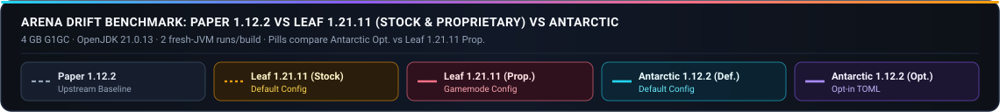
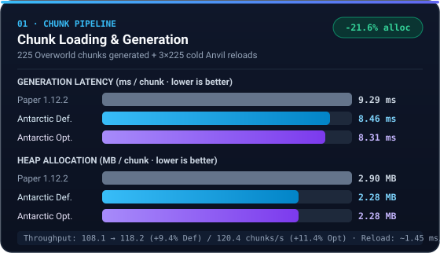
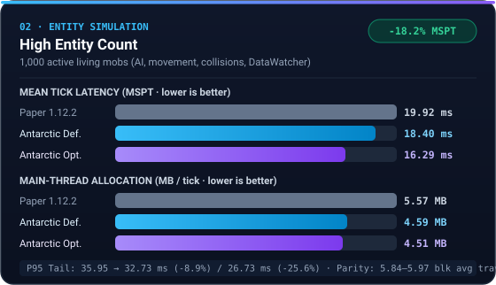
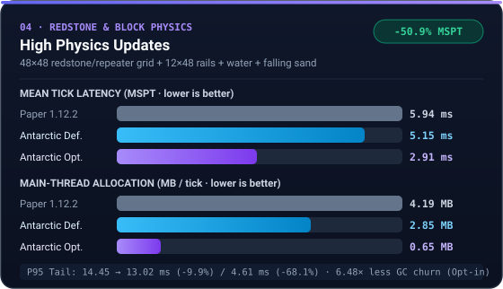

<div align="center">
  <br />
  
  <h1>Antarctic</h1>
  <p><strong>A modern, low-latency Paper <code>1.12.2</code> overhaul engineered for Java 21+</strong></p>

  <p>
    <a href="https://www.minecraft.net/"></a>
    <a href="https://adoptium.net/"></a>
    <a href="https://gradle.org/"></a>
    <a href="LICENSE.md"></a>
  </p>

  <p>
    <a href="#architecture--highlights">Highlights</a> &nbsp;&bull;&nbsp;
    <a href="#benchmarks">Benchmarks</a> &nbsp;&bull;&nbsp;
    <a href="#quick-start--building-from-source">Quick Start</a> &nbsp;&bull;&nbsp;
    <a href="#configuration">Configuration</a> &nbsp;&bull;&nbsp;
    <a href="#branches">Branches</a>
  </p>
</div>

---

**Antarctic** is a high-performance Paper `1.12.2` server fork rebuilt for **Java 21+**. It targets main-thread tick latency, heap allocation churn, and legacy concurrency bottlenecks using lock-free data structures, cache-friendly primitive pipelines, and simulation-tested vanilla parity — while preserving `1.12.2` client, Anvil storage, and Bukkit/Paper plugin compatibility.

> [!IMPORTANT]
> **Java 21+ Required:** Unlike vanilla and upstream Paper `1.12.2`, Antarctic is compiled with `--release 21` and **requires Java 21 or newer (Java 21+)** at runtime. Older JVMs (Java 8, 11, 17) are not supported.

---

## Architecture & Highlights

<table>
  <tr>
    <td width="50%" valign="top">
      <h3>&#9889; Zero-Alloc Hot Paths &amp; Networking</h3>
      <p>Eliminates per-tick heap churn across core loops: lock-free dense <code>DataWatcher</code> arrays, supplier-dispatched <code>EnumProtocol</code>, pooled Netty framing &amp; zlib codecs, cached <code>FastVoxelCache</code> collision shapes, zero-alloc bitmask crafting, and shared latency broadcasts.</p>
    </td>
    <td width="50%" valign="top">
      <h3>&#129521; Worldgen, Chunks &amp; Lighting</h3>
      <p>Accelerates chunk generation and loading with thread-local <code>IntCache</code> &amp; <code>PooledBlockPosition</code>, non-atomic <code>FastRandom</code>, pooled Anvil <code>Inflater</code> streams, palette-LUT light cell packing, and optional asynchronous bulk relight with border verification.</p>
    </td>
  </tr>
  <tr>
    <td width="50%" valign="top">
      <h3>&#128293; Physics, Redstone &amp; Entities</h3>
      <p>Combines an intrusive-heap <code>ChunkIndexedTreeSet</code>, wave-BFS fluid propagation, O(1) chunk-indexed <code>EntityTracker</code> queries, flat-array <code>PathfinderGoalSelector</code>, optional <strong>Alternate Current</strong> redstone, and optimized powered-rail propagation.</p>
    </td>
    <td width="50%" valign="top">
      <h3>&#128737; Vanilla Parity &amp; Java 21+ Runtime</h3>
      <p>Attempts to preserve vanilla movement, suffocation, redstone, and mob-spawning logic as faithfully as possible through automated logic simulations, with virtual-thread auth/chat executors (<code>ReentrantLock</code>), TOML tuning, and exploit hardening.</p>
    </td>
  </tr>
</table>

---

## Benchmarks

> [!NOTE]
> **Simulation Disclaimer:** These measurements reflect controlled synthetic simulations of `dev` against pinned upstream Paper `1.12.2` and **Leaf `1.21.11`** (both Stock and our Proprietary gamemode config) on identical hardware and JDK 21. They are **not** indicative of real-world production performance. Cross-version note: `1.21.11` generates `384`-block Overworld terrain with 3D noise biomes and Brain AI vs `1.12.2`'s `256`-block terrain and goal-selector AI.

<div align="center">
  
</div>

<table>
  <tr>
    <td width="50%" align="center">
      
    </td>
    <td width="50%" align="center">
      
    </td>
  </tr>
  <tr>
    <td width="50%" align="center">
      
    </td>
    <td width="50%" align="center">
      
    </td>
  </tr>
</table>

<details>
<summary><strong>Detailed Aggregated Telemetry &amp; Scaling Methodology</strong></summary>
<br />

- **Host &amp; Runtime:** AMD Ryzen 7 7435HS (8C / 16T) &middot; OpenJDK `21.0.13` (Zulu) &middot; `-Xms4G -Xmx4G -XX:+UseG1GC`
- **Protocol:** 2&times; fresh-JVM headless runs per build (Paper `1.12.2`, Leaf `1.21.11` Stock, Leaf `1.21.11` Proprietary, Antarctic Default, Antarctic Opt-in TOML) executing an identical Bukkit scaling-drift plugin (`seed 1337`) across 5 incremental load checkpoints per scenario.
- **Measurement:** Pure active server tick CPU time via `getTickTimes()` / `MinecraftServer.h[]` (excludes idle tick sleep) and heap allocation via `ThreadMXBean.getThreadAllocatedBytes()`. Leaf `1.21.11` reports all-thread JVM allocation (`5.383 GB` Stock / `5.388 GB` Proprietary; `0.118`–`0.120 GB` main-thread) to capture off-thread worker churn.
- **Deltas &amp; Parity:** Table percentage deltas compare Antarctic against **Paper `1.12.2`**; chart header pills compare Antarctic Opt-in against **Leaf `1.21.11` Proprietary**. Mob survival at `3,000` mobs: `2,924` / `2,748` / `2,742` / `2,925` / `2,926` alive (`6.09`–`7.30` blocks average travel).
- **Opt-in TOML Profile:** `redstone.implementation = "alternate-current"`, `rails.optimize-powered-rails = true`, `lighting.async-bulk-relight = true`.

| Scenario (Peak Scale) | Metric | Paper `1.12.2` | Leaf `1.21.11` (Stock) | Leaf `1.21.11` (Prop.) | Antarctic (Default) | Antarctic (Opt-in) |
| :--- | :--- | ---: | ---: | ---: | ---: | ---: |
| **Chunk Gen &amp; Load** *(25 &rarr; 625 chunks, r=12)* | Total Gen Time (`s`) | `4.72` | `12.17` | `11.90` | `3.21` (`-32.0%`) | `3.38` (`-28.4%`) |
| | Anvil Reload (`ms` / `625c`) | `898.1` | `N/A*` | `N/A*` | `324.1` (`-63.9%`) | `333.5` (`-62.9%`) |
| | Heap Alloc (`GB`) | `1.493` | `5.383` *(all)* | `5.388` *(all)* | `0.396` (`-73.5%`) | `0.392` (`-73.7%`) |
| **High Entities** *(600 &rarr; 3,000 active mobs)* | Mean MSPT (`ms`) | `58.44` | `33.94` | `42.75` | `36.82` (`-37.0%`) | `37.08` (`-36.5%`) |
| | P95 MSPT (`ms`) | `73.00` | `42.73` | `55.79` | `47.01` (`-35.6%`) | `46.49` (`-36.3%`) |
| | Heap Alloc (`MB/tick`) | `14.62` | `4.74` *(all)* | `4.91` *(all)* | `0.73` (`-95.0%`) | `0.71` (`-95.1%`) |
| **High Items** *(600 &rarr; 3,000 active items)* | Mean MSPT (`ms`) | `18.41` | `6.87` | `7.82` | `5.75` (`-68.8%`) | `5.84` (`-68.3%`) |
| | P95 MSPT (`ms`) | `25.06` | `8.26` | `10.49` | `8.48` (`-66.2%`) | `8.73` (`-65.2%`) |
| | Heap Alloc (`MB/tick`) | `3.96` | `2.15` *(all)* | `2.13` *(all)* | `0.27` (`-93.2%`) | `0.24` (`-93.9%`) |
| **High Physics** *(1&times; &rarr; 16&times; lag machines)* | Mean MSPT (`ms`) | `84.23` | `32.02` | `35.43` | `47.48` (`-43.6%`) | `23.60` (`-72.0%`) |
| | P95 MSPT (`ms`) | `184.76` | `55.18` | `64.91` | `126.19` (`-31.7%`) | `36.00` (`-80.5%`) |
| | Heap Alloc (`MB/tick`) | `42.51` | `27.82` *(all)* | `28.20` *(all)* | `12.12` (`-71.5%`) | `2.79` (`-93.4%`) |

> \* **Leaf `1.21.11` Reload:** Deferred chunk unloading kept the 625 generated chunks resident in memory during synchronous `unloadChunk`, so cold disk reload is omitted (`N/A*`).

</details>

---

## Quick Start &amp; Building from Source

- **Runtime Requirement:** **Java 21+** (`java -jar Antarctic-b<year>.<month>.jar`). Older Java versions (8 / 11 / 17) will fail to start.
- **Build Prerequisites:** **JDK 21+** (`JAVA_HOME`), **JDK 8** (`JAVA8_HOME`, first-time `setupSources` decompile/remap only), **Git**, **Python 3**, and **Bash** (Git Bash on Windows).

```bash
# 1. Clone the repository (dev branch)
git clone https://github.com/LUCKYVN-NETWORK/Antarctic.git
cd Antarctic

# 2. Decompile upstream Paper 1.12.2 and apply Antarctic patches
./gradlew setupSources

# 3. Build the standalone runnable server JAR
./gradlew buildServerJar
```

The runnable server archive is emitted to `Antarctic-Server/build/libs/Antarctic-b<year>.<month>.jar` (stamped with the build date, e.g. `Antarctic-b2026.11.jar`).

<details>
<summary><strong>Contributor Patch Workflow</strong></summary>
<br />

```bash
# Re-apply patches cleanly from antarctic-upstream
./gradlew applyPatches

# Export committed inner-repo changes back into Antarctic-API/ and Antarctic-Server/ patch folders
./gradlew rebuildPatches

# Verify patch round-trip and full test suites
bash scripts/test-patches.sh
./gradlew :Antarctic-API:test :Antarctic-Server:test
```

</details>

---

## Configuration

Antarctic ships with strict `1.12.2` vanilla defaults in **`antarctic.toml`** and exposes modular opt-in engines for high-load servers:

| Module | Key Options | Default |
| :--- | :--- | :--- |
| `[optimizations.physics]` | `optimize-voxel-collisions` | `true` |
| `[optimizations.redstone]` | `implementation` (`"vanilla"` \| `"eigencraft"` \| `"alternate-current"`) | `"vanilla"` |
| `[optimizations.rails]` | `optimize-powered-rails` | `false` |
| `[optimizations.lighting]` | `defer-light-updates`, `async-bulk-relight`, `verify-after-relight` | `true` / `false` / `true` |
| `[optimizations.mob-spawning]` | `support-first-spawn-filtering`, `precheck-light-mode`, `per-player-mob-spawns` | `true` / `"single-roll"` / `false` |
| `[concurrency.*]` | `virtual-threads.chat-executor`, `virtual-threads.authenticator`, `async-playerdata-saving` | `true` / `true` / `false` |

---

## Branches

| Branch | Role |
| :--- | :--- |
| **[`dev`](https://github.com/LUCKYVN-NETWORK/Antarctic/tree/dev)** *(default)* | Active development, audited backports, and performance engineering. Target all PRs here. |
| **[`main`](https://github.com/LUCKYVN-NETWORK/Antarctic/tree/main)** *(protected)* | Production-verified snapshots and release builds. |

---

## License &amp; Credits

- Licensed under **[GPL-3.0](LICENSE.md)** (inheriting Paper, Spigot, and CraftBukkit) with designated components under **[MIT](LICENSE.md#the-mit-license-mit)**.
- Built on the shoulders of [PaperMC](https://papermc.io/), [SpigotMC](https://www.spigotmc.org/), [Alternate Current](https://github.com/SpaceWalkerRS/alternate-current), [Dionysus](https://github.com/nopjmp/Dionysus), [Pufferfish](https://github.com/pufferfish-gg/Pufferfish), [Leaf](https://github.com/Winds-Studio/Leaf), and [FlamePaper](https://github.com/2LStudios-MC/FlamePaper).
